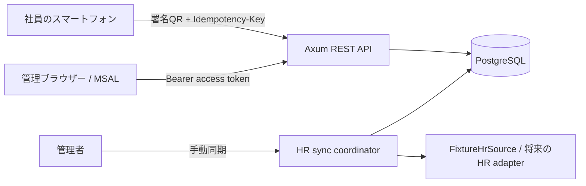

# 設計判断

## コンテキスト

このアプリは、勤怠イベント、外部HRスナップショット、アクセス権限を扱う独立したポートフォリオ用デモです。架空のデータだけを含み、実際の勤怠サービスやHRベンダーには接続しません。

## モジュール境界

| モジュール | 責務 |
|---|---|
| `qr/` | 秘密鍵の安全な保持、署名QR発行・検証 |
| `attendance/` | 勤務日境界、出退勤レコード形状 |
| `auth/` | 認証アダプターとEntra JWT検証 |
| `org/` | 部門identity、コード別名、親子階層の検証 |
| `hr/` | 完全スナップショットと社員プロフィールの検証・fingerprint |
| `authz/` | HR由来スコープの差分計算。手動権限には触れない |
| `sync/` | HRの段階状態、リトライ、各段階のDB反映 |
| `api/` | RESTハンドラー、認証、管理者・部門スコープのバックエンド判定 |
| `frontend/src/auth/` | MSAL／開発アダプター、戻り先検証、ルート保護 |
| `frontend/src/features/` | 出退勤、QR管理、部門権限、HR同期の画面とview model |

## QRと出退勤

QRトークンは `qra1.<kind>.<revision>.<signature>` 形式です。HMAC-SHA256の入力にはバージョン、`QR_SITE_ID`、用途（`check_in` / `check_out`）、リビジョンを含めます。署名はBase64URLで表し、日付・時刻を入力に含めないため、掲示したコードは更新されるまで安定します。

QR鍵は `QrSigner` に保持し、型に `Debug` / `Display` を実装していません。環境変数から32バイト以上のBase64鍵を読み込み、不正な鍵・署名は拒否します。比較にはHMACの定時間検証を使い、トークンはDBに保存しません。

有効性は署名だけでは決まりません。APIはDBの用途ごとの現行リビジョンと `active` を読み、用途・リビジョン・署名が一致する場合だけ受理します。管理者の更新は `expected_revision` をロック付きで比較してから増分し、監査履歴へ記録します。更新のcommit直後に旧QRは一致しなくなります。並行する管理者が古いrevisionを送ると409を返します。

認証後に社員レコードを解決し、氏名・メール・社員番号が揃っていなければ打刻処理へ進みません。バックエンドはTokyoの日付を使います。`attendance_events` の一意制約は `(user_id, work_date, kind)` と `idempotency_key` の両方にあります。同じキーの再送は既存イベントを返し、違うキーで同日同アクションを再度登録すると409です。勤務日の仕様はアプリや端末のタイムゾーンで変わりません。

## HR同期の安全性

`HrSource` がHRデータ取得の境界です。現在は `FixtureHrSource` がJSON fixtureを返し、将来アダプターは同じ `HrSnapshot` に正規化できます。スナップショットには完全取得フラグ、部門、社員ごとの所属と職務コード項目の存在状態を含みます。

取得後、部門識別子とコード重複、親参照・循環、社員識別子、所属参照、必須職務コード項目を全体検証します。役職コードが明示的なnullなら「役職なし」です。フィールド自体が欠落した場合は不完全エクスポートとして検証段階で止めます。完全性の検証が成功するまで書き込み段階を呼びません。

部門identityは `identity_code` から決まり、表示名や親は属性です。同名部門の統合はしません。上流の主コード移行を継続IDとして扱う場合は、スナップショットに同じ `identity_code` と `aliases` を明示します。別のidentityのコードと衝突した場合、同期は失敗します。

同期段階は `fetch`、`validate`、`departments`、`people`、`authorizations` です。各書き込み段階はトランザクション内で行い、run/stageの状態と安全な失敗詳細を保存します。部門段階がcommitした後で社員段階のDBエラーが起きた場合、先の段階は保持されます。入力の全体検証は既に成功しており、再実行は差分upsertと一意制約で安全に収束します。この段階ごとのcheckpointは進行状況を観測しやすくする代わりに、DB障害が段階間で発生したときに一時的な部分反映を許す設計です。

スナップショットは社員・部門・所属の順序を正規化してSHA-256 fingerprintを作ります。同じfingerprintの成功済みrunがあれば、再同期はno-opとしてステージに表示し、データ・監査ログを追加しません。

## 自動権限と手動権限

管理者ロールは `user_roles(user_id, role, grant_source)`、部門閲覧範囲は `manager_scopes(user_id, department_id, grant_source)` として保存します。`grant_source` は `manual` / `external_hr_role` で、複合主キーにも含まれます。同じユーザー・部門に両方が存在しても独立します。

同期ポリシーはデモ用コード `HR_ADMIN` / `EXECUTIVE_SPONSOR` を管理者、`DEPT_MANAGER` / `AREA_MANAGER` / `TEAM_LEAD` を所属部門のマネージャーとして扱います。手動APIは `manual` 行だけを挿入・削除し、HR同期は `external_hr_role` 行だけを差分で挿入・削除します。HRロール変更で自動行が消えても同じペアの手動行は残ります。付与・取消し監査は権限行のDBトランザクションと同じcommitに含めます。

画面のルート保護は利用者向けの説明に使います。認証済みユーザー解決、管理者確認、部門scope確認はバックエンドAPIで毎回実施します。`/attendance/scope` は管理者か、少なくとも1つ有効な部門scopeがある場合だけ結果を返します。

## 認証境界

フロントエンドは `AuthAdapter` のみを使い、開発アダプターまたはMSAL Browserの実装詳細を画面へ漏らしません。Entraアダプターは認可コード + PKCEのMSAL BrowserフローでAPI用アクセストークンを取得します。APIはIDトークンやクライアントから申告されたロールを信頼しません。

バックエンドのEntraアダプターはMicrosoft JWKSからRSA公開鍵を取得し、issuer/audience/RS256/期限/`nbf` を検証します。検証済み `oid` がactiveな `users.entra_oid` と一致する利用者だけを解決します。ローカル `X-Dev-User` は `AUTH_MODE=dev` だけで有効になり、`APP_ENV=production` との組み合わせは起動時に拒否します。

ログイン後の戻り先は同一originの許可済みアプリ内ルートに限定します。QR打刻URLはトークン文字の制約も検査します。プロフィールAPIが失敗したり必須プロフィールが不足したりした場合、打刻POSTは呼びません。

## APIとストレージの判断

SQLxの動的bind queryを使い、DBスキーマを `backend/migrations/` にまとめます。OpenAPI 3.1は `docs/openapi.yaml` を契約の読みやすい正本として管理し、バックエンドから同じファイルを `/api/openapi.yaml` で返します。現在の要件では、コード生成の複雑さを増やさず仕様と型をレビューできる形を優先しています。

`audit_events` はUPDATE/DELETEをトリガーで拒否し、QR更新、手動権限操作、同期結果をappend-onlyに記録します。HR同期の同一スナップショット再実行時は監査レコードを作りません。

## トレードオフと未実装の実システム連携

- HRサービスのAPI、認証、ページネーション、レート制限処理は未接続です。fixtureアダプターで再現性を優先しています。
- 勤怠ルールは「Tokyo日付あたり出勤・退勤各1回」です。夜勤、複数勤務、休憩、勤務修正ワークフローは実装していません。
- Entraユーザーの `oid` とHR社員コードの安全な初回照合フローは、会社ごとに異なるプロビジョニングのため実装していません。明示的な対応付け後のJWT認証を実装しています。
- 自動権限コード表はデモ定数です。実組織の職務コードや複雑な委任ルールを表すものではありません。
- 勤怠レコードに監査用修正・削除APIはありません。打刻は追記し、今回のデモでは修正ワークフローを範囲外にしています。
